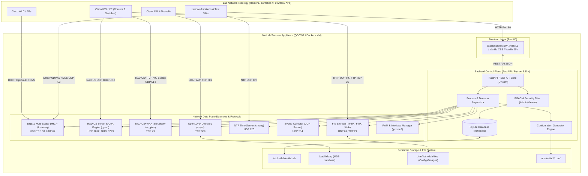
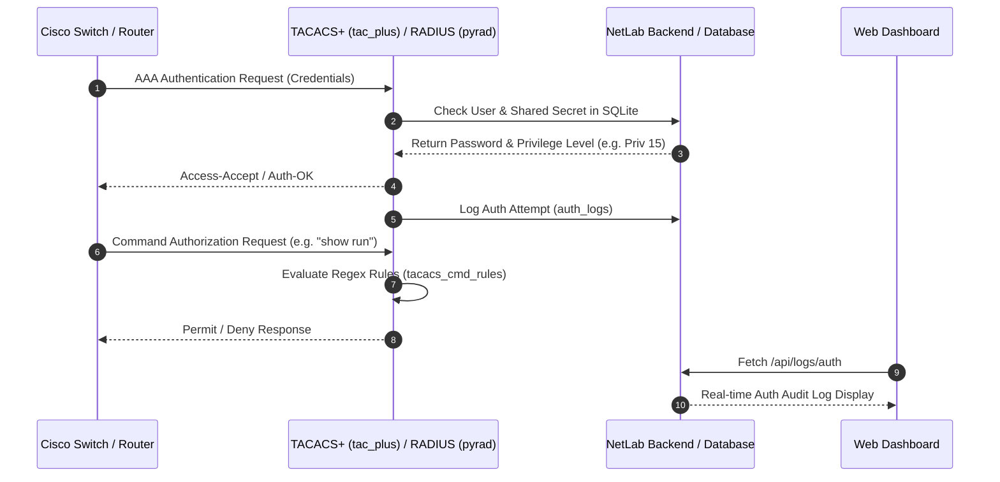
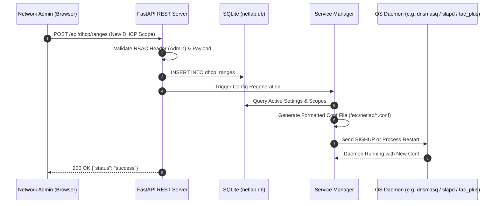

# Architecture & System Design Document

## Project: NetLab Services Appliance
**All-in-One Network Services Virtual Appliance for GNS3, EVE-NG, and Network Staging Labs**

---

### 1. System Architecture Overview

NetLab Services is architected as an ultra-lightweight, modular virtual appliance operating as a centralized control plane and network services hub. The architecture decouples the **Web Control Plane** (FastAPI + SQLite + Single Page Application) from the underlying **Service Execution Daemons** (`dnsmasq`, `tac_plus`, `slapd`, `chrony`, `pyrad`, `tftpy`, `pyftpdlib`, and Syslog UDP Receiver).



---

### 2. Technology Stack

| Layer | Technology | Version / Specification | Rationale & Purpose |
| :--- | :--- | :--- | :--- |
| **Target OS / Appliance Base** | **Alpine Linux** (Primary VM) / **Debian 12 Bookworm** (Container/Native) | Alpine 3.19+ / Debian 12 slim | Under 50MB base OS footprint, sub-5-second boot time, minimal RAM consumption (<128MB). |
| **Init & Process Supervisor** | **OpenRC** (Alpine) / **Systemd** (Ubuntu/Debian) | Native OS Init | Lightweight, non-blocking service lifecycle management and clean runlevel execution. |
| **Backend Framework** | **Python 3.11+ / FastAPI** | FastAPI >= 0.100.0 | High-performance asynchronous API framework with automatic OpenAPI documentation and native JSON serialization. |
| **ASGI Web Server** | **Uvicorn** | Uvicorn >= 0.22.0 | Ultra-fast ASGI web server handling HTTP requests and static asset routing on port 80. |
| **Database Engine** | **SQLite 3** | SQLite 3.x (WAL mode) | Embedded zero-configuration ACID database with zero external daemon memory overhead. |
| **DNS & DHCP Engine** | **dnsmasq** | 2.89+ | Industry standard combined DNS caching server and multi-scope DHCP server with raw socket broadcast capability. |
| **TACACS+ AAA Engine** | **Shrubbery tac_plus** | F4.0.4.28 (C source compiled) | Native Cisco-compliant TACACS+ daemon supporting authorization privilege levels (1-15), regex command rules, and accounting. |
| **RADIUS AAA Engine** | **pyrad** | >= 2.4 | Pure Python RFC 2865 / 2866 RADIUS implementation with dynamic CoA / Disconnect Message packet generation. |
| **LDAP Directory Engine** | **OpenLDAP (`slapd`) + `ldap3`** | OpenLDAP 2.6+ / ldap3 >= 2.9.1 | Lightweight LDAP server with MDB backend, schema support (`inetOrgPerson`, `posixGroup`), and Python directory synchronization. |
| **NTP Time Engine** | **Chrony** | 4.3+ | Fast-converging NTP daemon supporting local stratum 10 fallback for offline air-gapped lab networks. |
| **TFTP Server** | **tftpy** | >= 0.8.2 | Python-based RFC 1350 TFTP server integrated into backend process lifecycle. |
| **FTP Server** | **pyftpdlib** | >= 1.5.0 | High-throughput asynchronous FTP server supporting switch configuration staging. |
| **Frontend Architecture** | **HTML5 / Vanilla CSS3 / Vanilla JavaScript (ES6+)** | Single Page Application (SPA) | Zero npm/node build dependencies, instant rendering, dark-theme glassmorphism, responsive CSS grid/flexbox. |
| **Virtualization & Image** | **QEMU / KVM (`.qcow2`)** | VirtIO Net & Disk | Native format for GNS3, EVE-NG, CML, Proxmox, and OpenStack. |

---

### 3. Modular Component Architecture

#### 3.1 Control Plane: FastAPI Backend (`backend/main.py`)
- **Lifecycle Events**:
  - `startup`: Automatically runs `init_db()` to seed tables and default settings, starts background daemons (Syslog receiver, TFTP, FTP, RADIUS, and configured system daemons).
  - `shutdown`: Cleanly terminates active listener sockets and stops spawned daemon subprocesses.
- **RBAC Security Middleware**:
  - Inspects `X-User-Role` header on incoming requests.
  - Grants read access to `viewer` and `admin` roles; strictly restricts service modifications, deletions, and toggle operations to `admin`.
- **RESTful Endpoints**:
  - `/api/status`: Real-time telemetry (CPU, RAM, Disk, Uptime, Service states, Port audit).
  - `/api/services/{name}/toggle`: Individual service start/stop/restart control.
  - `/api/dns/*`: DNS records CRUD and upstream forwarder configuration.
  - `/api/dhcp/*`: DHCP multi-scope pools, static IP-MAC reservations, and active lease tracking.
  - `/api/radius/*`: RADIUS client & user management, CoA packet trigger.
  - `/api/tacacs/*`: TACACS+ client, user, privilege level, command authorization rules, and simulator.
  - `/api/ldap/*`: OpenLDAP user/group provisioning and directory synchronization.
  - `/api/ntp/*`: NTP pool settings and drift status.
  - `/api/files/*`: Central file staging, upload, download, and deletion.
  - `/api/network/interfaces`: Network adapter discovery, IP assignment, and link state toggling.
  - `/api/ipam/*`: Subnet management, IP address status tracking, and auto-discovery sync.
  - `/api/backup/*` & `/api/config/*`: SQLite snapshot export/import and structured JSON migration.

#### 3.2 Service Managers (`backend/services/`)
1. **`dns_dhcp.py` (`DnsmasqManager`)**:
   - Generates `/etc/netlab/dnsmasq.conf` dynamically from SQLite settings, DNS records, DHCP scopes, and static reservations.
   - Formats enterprise options (Option 43 WLC IP string/hex conversion, Option 66 TFTP, Option 42 NTP, Option 150 VoIP).
   - Manages `dnsmasq` process lifecycle; parses `/var/lib/misc/dnsmasq.leases` for live client IP, MAC, hostname, and expiration timestamps.
2. **`tacacs.py` (`TacacsManager`)**:
   - Generates `/etc/netlab/tac_plus.conf` specifying per-client encryption keys, accounting log path (`/var/log/tacacs_acct.log`), user privilege levels (1-15), default user authorization policies (`permit`/`deny`), and regex command authorization blocks.
   - Provides a standalone Python command evaluation simulator to test CLI strings against configured regular expressions.
3. **`radius_server.py` (`LabRadiusServer`)**:
   - Multi-threaded `pyrad` UDP server binding to `0.0.0.0:1812` (Auth) and `0.0.0.0:1813` (Acct).
   - Generates and maintains a standard RFC RADIUS dictionary on disk.
   - Validates client IP against configured NAS secrets and checks PAP/CHAP user passwords.
   - Implements RFC 3576 / RFC 5176 CoA / Disconnect Message packet generation sent to target NAS ports (default UDP 3799).
   - Records authentication attempts directly into `auth_logs` table.
4. **`ldap.py` (`LdapManager`)**:
   - Configures OpenLDAP `slapd.conf` including schemas (`core.schema`, `cosine.schema`, `inetorgperson.schema`).
   - Manages `slapd` daemon execution; connects over local loopback using `ldap3` to sync users (`inetOrgPerson`, `posixAccount`) and groups (`posixGroup`).
5. **`ntp.py` (`NtpManager`)**:
   - Generates `/etc/netlab/chrony.conf` with `local stratum 10` fallback, `allow all` subnet directive, and configured upstream pools.
   - Monitors NTP daemon status and active peer synchronization.
6. **`syslog_server.py` (`SyslogServer`)**:
   - Asynchronous UDP socket listener on port 514.
   - Parses RFC 3164 and RFC 5424 headers (PRI calculation for facility and severity).
   - Maintains an in-memory thread-safe rolling ring buffer of 1,000 entries with full-text search and severity filtering.
7. **`tftp.py` (`TftpManager`) & `ftp.py` (`FtpManager`)**:
   - Hosts files from shared root `/var/lib/netlab/files`.
   - `tftpy` manages UDP 69 requests; `pyftpdlib` provides standard FTP access on TCP 21.
8. **`network_mgr.py` (`NetworkInterfaceManager`)**:
   - Queries system network state using `ip -j addr show` with fallback parser for BusyBox/Alpine `/sys/class/net`.
   - Writes persistent interface configurations to `/etc/network/interfaces` and updates runtime IP addresses via `ip addr add/del` and `ip link set up/down`.
9. **`ipam.py` (`IpamManager`)**:
   - Validates IPv4 CIDR blocks using Python `ipaddress`.
   - Computes total, usable, allocated, and available host addresses.
   - Auto-discovers and synchronizes allocations from DHCP dynamic leases, static reservations, and system interface IPs.

---

### 4. Database Schema & Data Models

NetLab Services uses an embedded SQLite database (`/etc/netlab/netlab.db`).

```mermaid
erDiagram
    SETTINGS {
        string key PK
        string value
    }

    DNS_RECORDS {
        int id PK
        string hostname UK
        string ip_address
        string record_type
    }

    DHCP_RANGES {
        int id PK
        string name
        string start_ip
        string end_ip
        string netmask
        string gateway
        string dns_servers
        string domain_name
        string lease_time
        string interface
        string primary_wlc
        string secondary_wlc
        string tertiary_wlc
        string option_43_hex
        string ntp_servers
        string tftp_server
        string custom_options
    }

    DHCP_STATIC {
        int id PK
        string mac_address UK
        string ip_address UK
        string hostname
    }

    RADIUS_CLIENTS {
        int id PK
        string ip_network UK
        string shared_secret
        string name
    }

    RADIUS_USERS {
        int id PK
        string username UK
        string password
    }

    TACACS_CLIENTS {
        int id PK
        string ip_network UK
        string shared_secret
        string name
    }

    TACACS_USERS {
        int id PK
        string username UK
        string password
        int privilege
        string default_action
    }

    TACACS_CMD_RULES {
        int id PK
        string username
        string command
        string argument_regex
        string action
    }

    LDAP_USERS {
        int id PK
        string username UK
        string password
        string email
        string first_name
        string last_name
    }

    LDAP_GROUPS {
        int id PK
        string group_name UK
        string description
    }

    LDAP_GROUP_MEMBERS {
        int group_id PK, FK
        int user_id PK, FK
    }

    IPAM_SUBNETS {
        int id PK
        string name
        string cidr UK
        int vlan_id
        string vrf
        string gateway
        string description
    }

    IPAM_ADDRESSES {
        int id PK
        int subnet_id FK
        string ip_address
        string status
        string hostname
        string mac_address
        string description
        datetime last_seen
    }

    AUTH_LOGS {
        int id PK
        datetime timestamp
        string service
        string username
        string client_ip
        string status
        string message
    }

    WEB_USERS {
        int id PK
        string username UK
        string password_hash
        string role
    }

    INTERFACE_CONFIGS {
        string ifname PK
        string mode
        string ip_address
        string netmask
        string gateway
        string dns_servers
        int is_up
    }

    LDAP_GROUPS ||--o{ LDAP_GROUP_MEMBERS : contains
    LDAP_USERS ||--o{ LDAP_GROUP_MEMBERS : belongs_to
    IPAM_SUBNETS ||--o{ IPAM_ADDRESSES : allocates
```



---

### 5. Repository Directory & Folder Structure

```
/app/python/projects/multi-vm/
├── Dockerfile                      # Multi-service Debian Bookworm container definition
├── README.md                       # Comprehensive project overview and Cisco lab configs
├── prd.md                          # Product Requirements Document (PRD)
├── architecture.md                 # Technical Architecture & System Design Document
├── mindmap.md                      # System Architecture Linking Graph & Mind Map
├── man.md                          # Manual Page and Command Reference
├── phase.md                        # Development, Feature Delivery & Deployment Roadmap
├── docker-compose.yml              # Docker Compose deployment definition (NET_ADMIN cap)
├── entrypoint.sh                   # Container startup and database initialization script
├── install.sh                      # Automated native installer for Debian / Ubuntu server
├── setup_alpine.sh                 # Alpine Linux VM chroot customization script
├── alpine-make-vm-image            # Alpine VM image creation utility
├── netlab-services.gns3a           # GNS3 Appliance import template definition
├── netlab-services.qcow2           # Prebuilt bootable Alpine Linux QEMU virtual disk (616MB)
├── netlab.db                       # Seeded SQLite configuration database
├── backend/                        # FastAPI Backend & Service Managers
│   ├── database.py                 # SQLite database initialization, schemas & migration
│   ├── main.py                     # FastAPI REST API endpoints, routing, RBAC & supervisor
│   ├── requirements.txt            # Python dependencies (FastAPI, pyrad, ldap3, tftpy, pyftpdlib)
│   └── services/                   # Protocol & Service Implementations
│       ├── dns_dhcp.py             # Dnsmasq DNS/DHCP configuration manager & lease reader
│       ├── ftp.py                  # Pyftpdlib FTP server daemon manager
│       ├── ipam.py                 # IP Address Management (IPAM) engine & auto-sync
│       ├── ldap.py                 # OpenLDAP slapd configuration manager & ldap3 sync
│       ├── network_mgr.py          # Linux network interface discovery & config manager
│       ├── ntp.py                  # Chrony NTP time server manager
│       ├── radius_server.py        # Pyrad RFC 2865/2866 RADIUS server & CoA generator
│       ├── syslog_server.py        # Asynchronous UDP 514 Syslog collector & parser
│       ├── tacacs.py               # Shrubbery tac_plus AAA manager & command simulator
│       └── tftp.py                 # Tftpy TFTP server daemon manager
├── frontend/                       # Responsive Single-Page Application (SPA)
│   ├── index.html                  # Single-page HTML5 dashboard layout
│   ├── css/
│   │   └── style.css               # Glassmorphic dark theme CSS design system
│   └── js/
│       └── app.js                  # Vanilla JavaScript SPA logic, API client & UI renderers
├── skel/                           # Skeleton filesystem overrides for Alpine VM
│   ├── etc/                        # Initial configuration files (/etc/init.d, /etc/network)
│   └── opt/                        # Target installation directory skeleton
└── venv/                           # Python 3 Virtual Environment
```

---

### 6. Data & Control Flow Architectures

#### 6.1 Authentication & AAA Flow (TACACS+ / RADIUS)


#### 6.2 Web UI Configuration Update Flow


---

### 7. Process Supervision & Appliance Lifecycle

1. **Boot Initialization**:
   - The appliance boots in under 5 seconds via OpenRC / systemd.
   - Network interfaces bring up default loopback and management interfaces (`eth0`).
   - `netlab-services.service` executes `/app/entrypoint.sh`.
   - `entrypoint.sh` initializes missing storage paths (`/etc/netlab`, `/var/lib/ldap`, `/var/lib/misc`, `/var/lib/netlab/files`), runs `database.py` for schema verification, and launches Uvicorn.
2. **Runtime Process Supervisor**:
   - The FastAPI backend maintains references to daemon subprocesses and threads.
   - Enabling or disabling a service via the Web UI dynamically spawns or terminates the corresponding daemon process without requiring a full appliance reboot.
   - Service state changes write to the persistent SQLite database, ensuring state preservation across reboots.
3. **Backup, Restore & Migration Pipeline**:
   - Binary SQLite snapshots (`.db`) can be downloaded and restored with integrity validation.
   - Declarative JSON configurations (`netlab_config.json`) enable version-controlled lab blueprints and topology sharing across multiple engineers.
