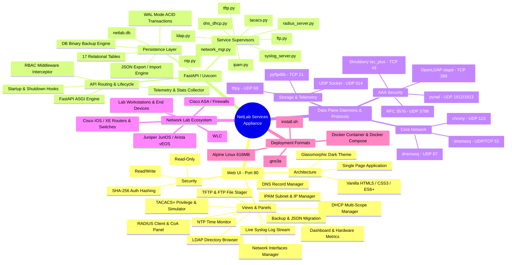
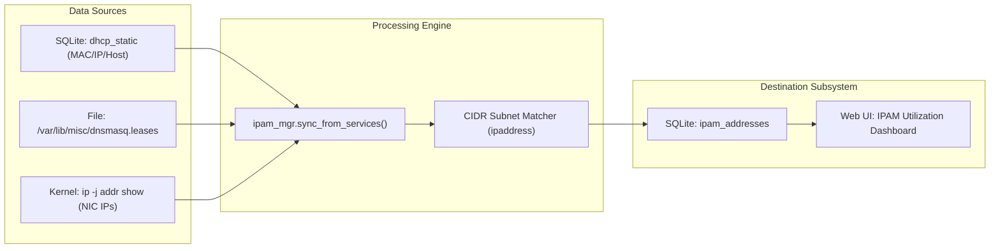
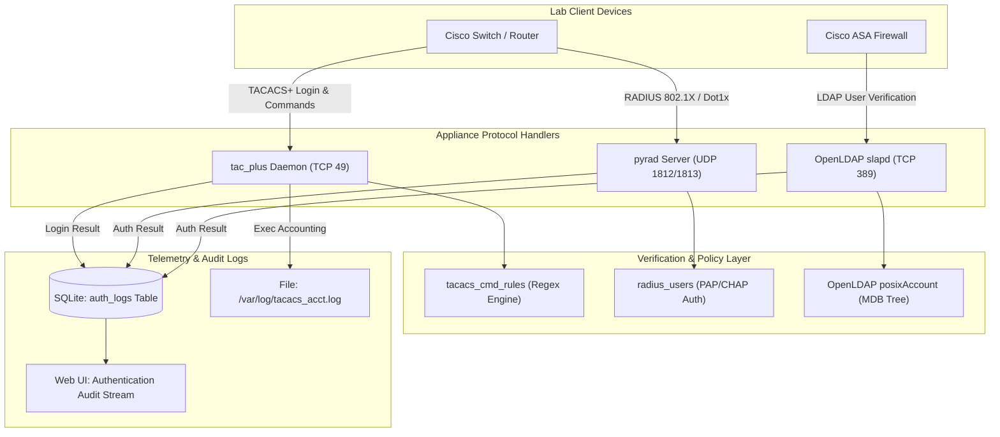
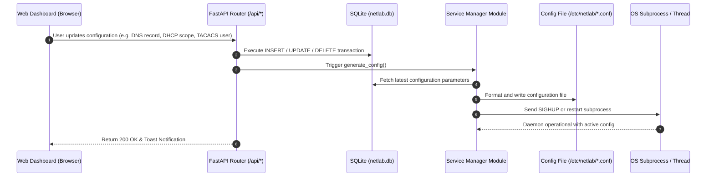

# NetLab Services - Complete System Linking Graph & Mind Map

This document provides visual relationship maps, dependency graphs, and architecture mind maps linking every component, protocol, database entity, backend manager, frontend view, and network client in the **NetLab Services** appliance.

---

## 1. System Ecosystem Mind Map



---

## 2. Comprehensive System Linking Graph

This graph maps the interconnections between **Users**, **Frontend Controllers**, **API Routers**, **Service Managers**, **Database Tables**, **Runtime Daemons**, **Filesystem Paths**, and **Lab Network Clients**.

```mermaid
graph TB
    %% User & Client Layer
    subgraph "External Actors & Lab Topology"
        AdminUser["👤 Admin / Viewer (Web Browser)"]
        CiscoRouter["🌐 Cisco IOS / XE Switch & Router"]
        CiscoASA["🛡️ Cisco ASA / Fortinet Firewall"]
        CiscoWLC["📡 Cisco Wireless LAN Controller"]
        LabHost["💻 Lab Client Workstations"]
    end

    %% Frontend Layer
    subgraph "Frontend Layer (Single Page Application)"
      UI_Main["🖥️ index.html / app.js"]
      UI_Dash["📊 Dashboard & Stats View"]
      UI_IPAM["🗺️ IPAM & Subnet View"]
      UI_DNS["🌐 DNS Records View"]
      UI_DHCP["📶 DHCP Scopes & Leases View"]
      UI_TACACS["🛡️ TACACS+ & Rule Simulator"]
      UI_RADIUS["🔐 RADIUS & CoA Trigger"]
      UI_LDAP["📂 LDAP User/Group View"]
      UI_NTP["⏰ NTP Status View"]
      UI_Files["📁 File Manager & Preview"]
      UI_Syslog["📋 Syslog Live Stream"]
      UI_Ifaces["🔌 Network Adapters View"]
      UI_Backup["💾 Backup & JSON Migration"]
    end

    %% Backend Layer
    subgraph "Backend Control Plane (FastAPI / Python 3.11+)"
      API_Router["⚡ FastAPI Core (main.py)"]
      RBAC_Guard["🔒 RBAC Middleware (Admin vs Viewer)"]
      
      subgraph "Service Management Engines"
        Mgr_DNS["DnsmasqManager"]
        Mgr_TAC["TacacsManager"]
        Mgr_RAD["RadiusServerManager & CoA"]
        Mgr_LDAP["LdapManager"]
        Mgr_NTP["NtpManager"]
        Mgr_LOG["SyslogServer"]
        Mgr_TFTP["TftpManager"]
        Mgr_FTP["FtpManager"]
        Mgr_NET["NetworkInterfaceManager"]
        Mgr_IPAM["IpamManager"]
      end
    end

    %% Database Layer
    subgraph "Database Layer (SQLite / netlab.db)"
      DB_Settings[("settings")]
      DB_DNS[("dns_records")]
      DB_DHCP[("dhcp_ranges & dhcp_static")]
      DB_TAC[("tacacs_clients, users, rules")]
      DB_RAD[("radius_clients, users")]
      DB_LDAP[("ldap_users, groups, members")]
      DB_IPAM[("ipam_subnets & ipam_addresses")]
      DB_Logs[("auth_logs")]
      DB_Ifaces[("interface_configs")]
      DB_Users[("web_users")]
    end

    %% Operating System & Daemons
    subgraph "System Daemons & Storage Paths"
      Proc_Dnsmasq["⚙️ dnsmasq Process (DNS & DHCP)"]
      Proc_TacPlus["⚙️ tac_plus Daemon (Shrubbery)"]
      Proc_Slapd["⚙️ slapd Daemon (OpenLDAP)"]
      Proc_Chrony["⚙️ chronyd Daemon (NTP)"]
      Proc_Radius["⚙️ pyrad Thread (RADIUS)"]
      Proc_Syslog["⚙️ UDP 514 Socket (Syslog)"]
      Proc_Tftp["⚙️ tftpy Thread (TFTP)"]
      Proc_Ftp["⚙️ pyftpdlib Thread (FTP)"]
      
      File_DnsConf["📄 /etc/netlab/dnsmasq.conf"]
      File_Leases["📄 /var/lib/misc/dnsmasq.leases"]
      File_TacConf["📄 /etc/netlab/tac_plus.conf"]
      File_SlapdConf["📄 /etc/netlab/slapd.conf"]
      File_ChronyConf["📄 /etc/chrony/chrony.conf"]
      File_LdapMDB["📂 /var/lib/ldap/ (MDB)"]
      File_Shared["📂 /var/lib/netlab/files/ (Configs/Images)"]
      File_NetIface["📄 /etc/network/interfaces"]
    end

    %% Wiring Connections: User to UI
    AdminUser -->|HTTP Port 80| UI_Main
    UI_Main --> UI_Dash
    UI_Main --> UI_IPAM
    UI_Main --> UI_DNS
    UI_Main --> UI_DHCP
    UI_Main --> UI_TACACS
    UI_Main --> UI_RADIUS
    UI_Main --> UI_LDAP
    UI_Main --> UI_NTP
    UI_Main --> UI_Files
    UI_Main --> UI_Syslog
    UI_Main --> UI_Ifaces
    UI_Main --> UI_Backup

    %% UI to Backend
    UI_Dash & UI_IPAM & UI_DNS & UI_DHCP & UI_TACACS & UI_RADIUS & UI_LDAP & UI_NTP & UI_Files & UI_Syslog & UI_Ifaces & UI_Backup -->|REST API Requests| API_Router
    API_Router --> RBAC_Guard

    %% Backend to Service Managers
    API_Router --> Mgr_DNS
    API_Router --> Mgr_TAC
    API_Router --> Mgr_RAD
    API_Router --> Mgr_LDAP
    API_Router --> Mgr_NTP
    API_Router --> Mgr_LOG
    API_Router --> Mgr_TFTP
    API_Router --> Mgr_FTP
    API_Router --> Mgr_NET
    API_Router --> Mgr_IPAM

    %% Backend & Managers to Database
    RBAC_Guard --> DB_Users
    Mgr_DNS --> DB_Settings & DB_DNS & DB_DHCP
    Mgr_TAC --> DB_Settings & DB_TAC
    Mgr_RAD --> DB_Settings & DB_RAD & DB_Logs
    Mgr_LDAP --> DB_Settings & DB_LDAP
    Mgr_NTP --> DB_Settings
    Mgr_NET --> DB_Ifaces
    Mgr_IPAM --> DB_IPAM

    %% Cross-Subsystem Auto-Sync Link
    Mgr_IPAM -.->|Auto-Discover Allocations| File_Leases
    Mgr_IPAM -.->|Sync Interfaces| Mgr_NET

    %% Managers to Files & Daemons
    Mgr_DNS -->|Generates| File_DnsConf -->|Spawns| Proc_Dnsmasq
    File_Leases -.->|Parsed By| Mgr_DNS
    Mgr_TAC -->|Generates| File_TacConf -->|Spawns| Proc_TacPlus
    Mgr_LDAP -->|Generates| File_SlapdConf -->|Spawns| Proc_Slapd
    Proc_Slapd --> File_LdapMDB
    Mgr_NTP -->|Generates| File_ChronyConf -->|Spawns| Proc_Chrony
    Mgr_RAD -->|Controls| Proc_Radius
    Mgr_LOG -->|Receives To Buffer| Proc_Syslog
    Mgr_TFTP -->|Hosts| File_Shared -->|Serves| Proc_Tftp
    Mgr_FTP -->|Hosts| File_Shared -->|Serves| Proc_Ftp
    Mgr_NET -->|Writes| File_NetIface

    %% Daemons to Lab Network Clients
    Proc_Dnsmasq <-->|DNS UDP/TCP 53 & DHCP UDP 67| LabHost & CiscoRouter & CiscoWLC
    Proc_TacPlus <-->|TACACS+ AAA TCP 49| CiscoRouter
    Proc_Radius <-->|RADIUS Auth UDP 1812/1813| CiscoRouter
    Proc_Radius -->|CoA / Disconnect UDP 3799| CiscoRouter
    Proc_Slapd <-->|LDAP Auth TCP 389| CiscoASA
    Proc_Chrony <-->|NTP UDP 123| CiscoRouter & CiscoASA & LabHost
    Proc_Tftp <-->|TFTP UDP 69| CiscoRouter
    Proc_Ftp <-->|FTP TCP 21| CiscoRouter
    Proc_Syslog <--|Syslog UDP 514| CiscoRouter & CiscoASA
```

---

## 3. Cross-Subsystem Interaction & Dependency Links

### 3.1 IPAM Auto-Discovery & Cross-Service Data Linkage
The IPAM module dynamically bridges state from the network interfaces, DHCP static table, and active dynamic DHCP leases.



---

### 3.2 AAA Authentication, Authorization & Telemetry Pipeline
How TACACS+, RADIUS, and LDAP events correlate with database state and the live audit monitor.



---

### 3.3 Configuration Generation & Daemon Lifecycle Pipeline
How user actions in the Single Page Application cascade to configuration files, daemon reloads, and database persistence.



---

## 4. Summary of Subsystem Cross-Links

| Primary Subsystem | Linked Subsystem | Interaction Type | Shared Data / Asset |
| :--- | :--- | :--- | :--- |
| **DHCP Server** | **IPAM** | Auto-Discovery Sync | Active DHCP dynamic leases & static IP reservations |
| **DHCP Server** | **Network Interfaces** | Interface Binding | Scope binding to `eth0`, `eth1` physical adapters |
| **DHCP Server** | **DNS Server** | Shared Daemon Process | Both managed by unified `dnsmasq` instance |
| **RADIUS Server** | **Auth Audit Log** | Event Logging | Authentication attempts written to `auth_logs` |
| **TACACS+ Server** | **Auth Audit Log** | Event Logging | Authentication and command authorization events |
| **OpenLDAP Server** | **SQLite Database** | Data Synchronization | `ldap_users` and `ldap_groups` synced to OpenLDAP MDB tree |
| **TFTP Server** | **FTP Server** | Shared Filesystem | Shared storage root `/var/lib/netlab/files` |
| **Web File Manager** | **TFTP / FTP** | File CRUD | Web uploads and downloads share the staging directory |
| **FastAPI Core** | **All Daemons** | Process Supervision | Lifecycle startup, shutdown, restart, and telemetry polling |
| **Backup Manager** | **All Subsystems** | Snapshot / JSON Migration | Global state import/export across all 17 database tables |
