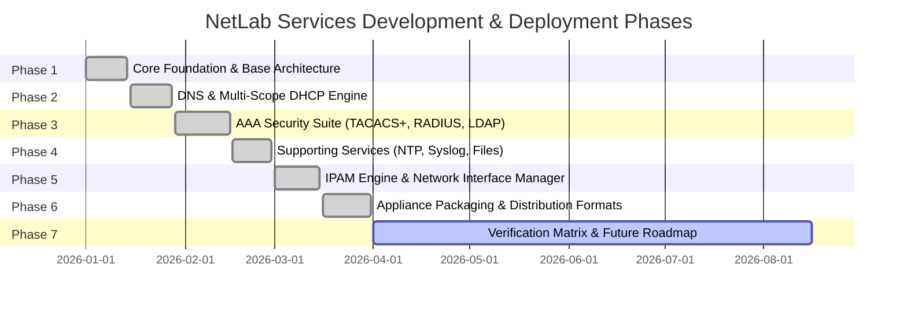

# Feature Deployment & Release Phases

## Project: NetLab Services Appliance
**Phased Implementation, Rollout Milestones, and Verification Matrix**

---

### Executive Summary of Phases

The NetLab Services Appliance project followed a structured, seven-phase development and deployment lifecycle. The phases progressed from foundational system design and lightweight OS virtualization, through core protocol implementation and enterprise AAA security suites, to automated packaging and multi-platform distribution.

---

### Phase 1: Foundation & Core Infrastructure

#### 1. Objectives
- Establish an ultra-lightweight virtual base system (<128MB RAM footprint, <5-second boot time).
- Build the core asynchronous backend API framework and database persistence layer.
- Design the dark-themed glassmorphic Single-Page Application (SPA) layout and design tokens.
- Implement Role-Based Access Control (RBAC) and security middleware.

#### 2. Delivered Features & Components
- **FastAPI Core (`backend/main.py`)**: Asynchronous API server running on Uvicorn on TCP port 80.
- **Persistence Layer (`backend/database.py`)**: SQLite 3 database (`netlab.db`) with tables for system settings, services, user accounts, and audit trails.
- **RBAC Security Engine**:
  - `admin` role with full configuration read/write and service restart privileges.
  - `viewer` role with read-only access to monitoring dashboards, IPAM views, and logs.
  - Constant-time SHA-256 password hashing.
  - API request interception via `X-User-Role` middleware headers.
- **Frontend Design System (`frontend/css/style.css`, `frontend/index.html`)**:
  - Glassmorphic dark theme using CSS variables (`--bg-primary`, `--card-bg`, `--accent`, `--border`).
  - Fluid sidebar navigation with responsive layout and status indicators.
  - Real-time hardware telemetry widgets (CPU load average, RAM utilization percentage, Disk storage usage, system uptime).

#### 3. Transition & Acceptance Criteria
- [x] Web dashboard serves in < 100ms.
- [x] Backend gracefully handles database initialization and migrations.
- [x] Unauthorized write requests from `viewer` role correctly return HTTP 403 Forbidden.

---

### Phase 2: Core Network Protocol Implementation (DNS & DHCP)

#### 2. Objectives
- Replace complex standalone DNS and DHCP configurations with an integrated manager.
- Enable multi-scope DHCP pools with advanced enterprise options required for network lab devices.
- Provide real-time active lease tracking.

#### 2. Delivered Features & Components
- **`dnsmasq` Service Manager (`backend/services/dns_dhcp.py`)**:
  - Dynamic generation of `/etc/netlab/dnsmasq.conf`.
  - Process lifecycle supervisor (start, stop, reload via SIGHUP/restart).
- **DNS Server Management**:
  - Local DNS A-records and PTR resolution.
  - Configurable upstream DNS forwarders (e.g. `8.8.8.8`, `1.1.1.1`).
  - Local domain protection (`domain-needed`, `bogus-priv`).
- **Multi-Scope DHCP Engine**:
  - Multiple distinct DHCP pools with customizable IP start/end ranges, netmasks, gateways, domain search names, and lease times.
  - Interface-specific DHCP binding (e.g. `eth0`, `eth1`).
  - Static DHCP reservations binding client MAC addresses to fixed IP addresses and hostnames.
- **Advanced Enterprise DHCP Options**:
  - **Option 43**: Cisco Wireless LAN Controller (WLC) AP discovery IP list (automatic conversion between IPv4 string and hex notation).
  - **Option 66 / 150**: TFTP boot server IP address / Cisco CallManager VoIP server address.
  - **Option 42**: NTP time server distribution.
  - **Custom Options**: Raw DHCP option insertion for specialized vendor hardware.
- **Active Lease Monitoring**:
  - Live parser for `/var/lib/misc/dnsmasq.leases`.
  - Interactive table displaying active IP allocations, client MAC addresses, hostnames, and expiration timestamps.

#### 3. Transition & Acceptance Criteria
- [x] Cisco router configured with `ip address dhcp` successfully obtains IP and default gateway within 3 seconds.
- [x] Cisco Aironet AP receives Option 43 and successfully joins simulated WLC.
- [x] DNS resolution resolves local lab hostnames and forwards external queries.

---

### Phase 3: AAA Security & Identity Services Suite

#### 1. Objectives
- Implement a complete authentication, authorization, and accounting (AAA) stack for network device administration and client access control.
- Support both TACACS+ (Cisco/Juniper device admin) and RADIUS (802.1X/network access), plus LDAP directory identity.

#### 2. Delivered Features & Components
- **TACACS+ Device Administration (`backend/services/tacacs.py`)**:
  - Integration and compilation of Shrubbery `tac_plus` (F4.0.4.28).
  - Configurable privilege levels (Privilege 1 to 15) per user.
  - Per-user default authorization actions (`permit` or `deny`).
  - Regex-based Command Authorization Rule Engine (`tacacs_cmd_rules`) enforcing granular CLI command permissions.
  - Web-based **Command Authorization Tester & Simulator** allowing engineers to test CLI strings against authorization rules prior to switch deployment.
  - TACACS+ accounting log generation (`/var/log/tacacs_acct.log`).
- **RADIUS Server & Dynamic Policy Engine (`backend/services/radius_server.py`)**:
  - Python-based RFC 2865 / RFC 2866 RADIUS server using `pyrad`.
  - Support for PAP and CHAP authentication methods.
  - Per-client Network Access Server (NAS) shared secrets.
  - **RADIUS Change of Authorization (CoA) / Disconnect Message (DM)** packet generator (RFC 3576 / RFC 5176) to trigger dynamic session drops on switches.
- **LDAP Directory Service (`backend/services/ldap.py`)**:
  - OpenLDAP (`slapd`) daemon integration with MDB database backend.
  - Standard organizational hierarchy (`ou=users`, `ou=groups`, `dc=netlab,dc=local`).
  - User and group management with automatic UID/GID generation.
  - Dual-way synchronization between SQLite database and OpenLDAP tree via `ldap3`.
  - Compatibility with Cisco ASA / Fortigate LDAP authentication server groups.
- **Live AAA Audit Log**:
  - Real-time audit log capturing service (TACACS/RADIUS/LDAP), client IP, username, auth status, and failure reasons.

#### 3. Transition & Acceptance Criteria
- [x] Cisco IOS router `aaa authentication login default group tacacs+` authenticates successfully.
- [x] Non-privileged user is blocked from executing `configure terminal` based on regex authorization rules.
- [x] Cisco ASA firewall verifies VPN user credentials against OpenLDAP directory.

---

### Phase 4: Supporting Lab Infrastructure & File Services

#### 1. Objectives
- Deploy reliable time synchronization, diagnostic telemetry, and network device file transfer services.
- Provide a web-based file management interface for IOS image and configuration staging.

#### 2. Delivered Features & Components
- **NTP Time Service (`backend/services/ntp.py`)**:
  - `chrony` NTP daemon integration.
  - Local Stratum 10 fallback mode ensuring clock distribution even when lab is isolated from the Internet.
  - Upstream NTP pool configuration and live tracking status.
- **Syslog Collector & Analyzer (`backend/services/syslog_server.py`)**:
  - Asynchronous UDP 514 syslog receiver.
  - RFC 3164 and RFC 5424 header parsing (calculating facility and severity 0-7).
  - Interactive UI with color-coded severity badges (Emergency through Debug).
  - Real-time text search, severity filter dropdown, and auto-refresh toggle.
- **Unified File Manager (`backend/services/tftp.py`, `backend/services/ftp.py`)**:
  - Shared storage directory at `/var/lib/netlab/files`.
  - Asynchronous TFTP server on UDP port 69 (`tftpy`).
  - High-performance FTP server on TCP port 21 (`pyftpdlib`).
  - Web UI drag-and-drop file uploader, file preview modal, download handler, and deletion manager.

#### 3. Transition & Acceptance Criteria
- [x] Cisco switch synchronizes clock via `ntp server <appliance-ip>`.
- [x] `logging host <appliance-ip>` displays real-time color-coded syslog messages on the dashboard.
- [x] `copy running-config tftp://<appliance-ip>/switch1.cfg` succeeds and appears in the Web File Manager.

---

### Phase 5: Advanced Network Operations (IPAM & Interface Manager)

#### 1. Objectives
- Eliminate spreadsheet-based IP address tracking in lab environments.
- Provide direct network adapter configuration from the Web UI.

#### 2. Delivered Features & Components
- **IP Address Management (IPAM) Engine (`backend/services/ipam.py`)**:
  - Subnet management tracking IPv4 CIDR blocks, subnet names, VLAN IDs, VRF instances, and gateways.
  - Real-time utilization calculation (Total IPs, Usable host count, Active count, DHCP dynamic count, DHCP static count, Reserved count, and visual percentage progress bars).
  - Global IPAM address search across subnets, hostnames, MAC addresses, and notes.
- **Automated IP Discovery & Cross-Service Synchronization**:
  - Auto-discovers and populates IPAM address records by querying active DHCP leases, static reservations, and system network interfaces with a single click.
- **Network Interface Manager (`backend/services/network_mgr.py`)**:
  - Live discovery of physical and virtual network adapters (`eth0`, `eth1`, etc.).
  - Configuration of static IPv4 parameters or DHCP client mode per interface.
  - Administrative link state control (Toggle UP / DOWN) directly from the dashboard.

#### 3. Transition & Acceptance Criteria
- [x] Adding a subnet recalculates usable host ranges accurately according to standard RFC 1918 rules.
- [x] Clicking "Sync from Services" auto-populates all active DHCP leases into IPAM table.
- [x] Interface IP modification applies immediately without dropping web session connectivity.

---

### Phase 6: Appliance Packaging, Optimization & Multi-Platform Distribution

#### 1. Objectives
- Package the solution into ready-to-run artifacts for every major virtualization platform.
- Optimize image size and boot time for large-scale multi-appliance topologies.

#### 2. Delivered Features & Components
- **Alpine Linux QEMU Virtual Appliance (`netlab-services.qcow2`)**:
  - Built using `alpine-make-vm-image` and `setup_alpine.sh`.
  - Total disk image footprint: 616 MB.
  - Idle RAM consumption: <128 MB on 1 vCPU.
  - OpenRC service configuration with automatic daemon initialization.
- **GNS3 Appliance Template (`netlab-services.gns3a`)**:
  - Standard JSON appliance template configured with VirtIO net adapters and Telnet serial console.
  - One-click import into GNS3 End Devices palette.
- **Native Debian / Ubuntu Host Installer (`install.sh`)**:
  - Automated bash installer compiling `tac_plus`, configuring OpenLDAP, setting up Python virtual environment, creating `netlab-services.service` systemd daemon, and configuring UFW firewall rules.
- **Docker Containerization (`Dockerfile`, `docker-compose.yml`)**:
  - Multi-service Debian Bookworm container with `NET_ADMIN` capability.
  - Volume persistence for database and LDAP storage.
- **Configuration Backup, Restore & Migration**:
  - SQLite snapshot download and upload with SQLite 3 binary validation.
  - Declarative JSON configuration export/import (`netlab_config.json`) for Git version control and lab topology template sharing.

#### 3. Transition & Acceptance Criteria
- [x] Appliance imports cleanly into GNS3 2.2+ without missing dependency warnings.
- [x] Native installer completes on clean Ubuntu 22.04 / 24.04 and Debian 12 servers in < 3 minutes.
- [x] JSON export/import successfully migrates all DNS, DHCP, TACACS+, RADIUS, and IPAM data.

---

### Phase 7: Verification Matrix & Future Release Roadmap

#### 1. Device Verification Test Matrix

| Network Platform | Tested Firmware | Validated Features | Status |
| :--- | :--- | :--- | :--- |
| **Cisco IOS / IOS-XE** | 15.6(2)T / 17.03.04 | DNS, DHCP, TACACS+ AAA, RADIUS Dot1x, NTP, TFTP, Syslog | **Verified (PASS)** |
| **Cisco ASA Firewall** | 9.14(1) | LDAP Authentication Server Group, Syslog, NTP | **Verified (PASS)** |
| **Cisco Wireless (vWLC)** | 8.10.151.0 | DHCP Option 43 Vendor Specific String & Hex auto-join | **Verified (PASS)** |
| **Juniper vSRX / vQFX** | JunOS 20.4R1 | TACACS+ Management Login, RADIUS Auth, NTP, Syslog | **Verified (PASS)** |
| **Arista vEOS** | 4.26.1F | TACACS+ AAA, DHCP Scope distribution, TFTP config backup | **Verified (PASS)** |

#### 2. Future Release Roadmap

| Milestone | Target Feature | Description |
| :--- | :--- | :--- |
| **v1.1.0** | **IPv6 Services Suite** | Support for DHCPv6 stateful/stateless scopes, SLAAC prefix delegation, and IPv6 DNS AAAA records. |
| **v1.2.0** | **802.1X EAP-TLS CA** | Built-in lightweight Certificate Authority (CA) to generate client/device X.509 certificates for EAP-TLS testing. |
| **v1.3.0** | **NetFlow / IPFIX Collector** | Asynchronous NetFlow v5/v9 and IPFIX telemetry receiver with top talkers visualization on the dashboard. |
| **v1.4.0** | **Multi-Tenancy & VRF Scopes** | Support for isolated multi-tenant routing domains with per-tenant DHCP/DNS/TACACS+ partitions. |
